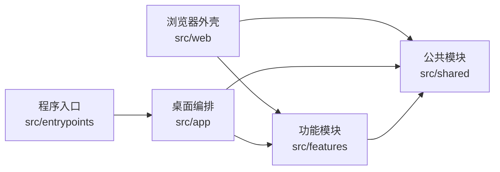
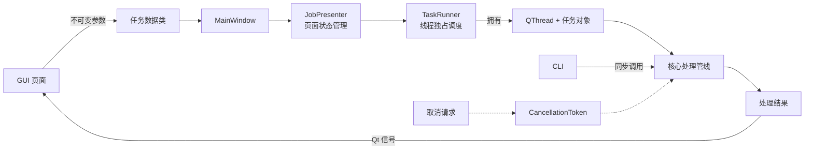

# 架构与数据流

<p align="left">
  <strong>简体中文</strong> · <a href="en/architecture.md">English</a>
</p>

## 设计目标

Purivox 采用界面层、业务功能模块与通用基础设施解耦的分层设计。桌面图形界面（GUI）与命令行（CLI）作为上层交互外壳，仅负责收集参数、调度执行并呈现进度与结果；核心音频处理管线封装为无 GUI 依赖的任务函数。该架构保证了 GUI、CLI 与 WebAssembly 浏览器端共享底层算法实现，并支持脱离界面的自动化集成与测试。

## 分层架构

```text
src/entrypoints/                 程序入口：启动 GUI 或解析 CLI 命令行
src/app/                         桌面应用外壳：主窗口、页面协调器与工作线程管理
src/features/                    业务功能实现：独立功能页面、数据模型与处理管线
├── reference_removal/           参考对消：音源匹配、时间线模型、双引擎与 DSP
├── stem_split/                  声学分轨：声道分派、互补分频、自适应声像分离与页面
├── home/                        应用首页与导航入口
└── settings/                    系统设置、语言主题与更新检查
src/shared/                      共享层：音频 I/O、通用 DSP、配置、日志、协议与通用 UI 控件
src/web/                         WebAssembly 浏览器端接口：JS 桥接、时间线序列化与内存配额
src/resources/                   静态资源：多语言翻译文件与矢量图标
```

系统依赖方向严格自顶向下：



`src/app` 与 `src/web` 是并列的两种外壳层：前者编排桌面 GUI，后者处理浏览器 WebAssembly 运行时的作业调度。

### 架构约束

`tests/test_architecture.py` 基于抽象语法树（AST）静态检查以下边界，防止架构侵蚀：
- `src/shared/` 严禁导入 `app`、`entrypoints` 或任何 `features`；
- 各功能模块（`features/`）之间严禁相互跨模块导入；
- `app` 与 `web` 严禁反向导入 `entrypoints`；
- 需复用于多个功能模块的算法与常量必须下沉至 `src/shared/` 统一维护（如 `BLOCK_FRAMES`、`AUDIO_EXTENSIONS`、`log_flux_bands()` 与 `validate_reference_settings()`）。

音源下载模块（基于 yt-dlp）作为通用工具位于 `src/shared/download/`，桌面 GUI 槽函数中采用按需动态导入，避免影响冷启动性能；WebAssembly 端不导入网络下载依赖。

## 任务执行模型

页面组件仅发出开始与取消信号，不直接管理底层线程生命周期。



1. **状态协调**：`MainWindow` 构造不可变任务数据对象，转交 `JobPresenter` 管理界面控件的启用/禁用与进度展示；结果由页面自己的 `show_result()` 展示，`JobPresenter` 不依赖任何功能模块；
2. **线程独占**：`shared/tasks.py` 的 `TaskRunner` 拥有 `QThread` 与任务对象的生命周期，确保单窗口同一时刻仅有一个后台任务处于运行状态；下载对话框的 `DownloadRunner` 复用同一个运行器；
3. **安全退出**：`TaskRunner` 仅在工作线程完成延迟删除（`deferred delete`）后发出 `finished` 信号，避免窗口关闭或测试析构时发生竞态；
4. **协作取消**：CLI 与 GUI 共用 `CancellationToken`。解码、分析、拉伸、矩阵解算与文件写出等密集循环定期调用 `raise_if_cancelled()`，确保及时响应中断请求。

## 音频数据与内存管理

系统核心音频载体为 `AudioData`，采用 `[channels, frames]` 形状的平面 `float32` 连续存储。长音频通过分块流式与内存映射结合处理：

- **流式分块**：音频解码、统计、重采样、写入等大开销操作统一以 `BLOCK_FRAMES = 262144` 帧为单位推进；
- **解码回退**：libsndfile 不直接支持的媒体格式回退至 Qt Multimedia 进行管道解码；
- **重采样**：重采样采用 libsoxr 的流式接口进行精确重采样；
- **内存映射**：桌面端处理长音频时，中间数据写入临时 `np.memmap` 磁盘文件，通过 `release_mapped_pages()` 及时释放非当前活跃页；
- **WebAssembly 适配**：由于 WebAssembly（Emscripten）的文件系统常驻堆内存，内存映射无法节省物理内存，浏览器端直接在堆内存中按需分配（详见[浏览器版说明](web.md)）；
- **原子写出**：文件保存采用同目录临时写入后原子替换（`os.replace`）策略，确保任务中断或异常退出不会损坏目标文件或生成不完整文件。

## 一条管线，双引擎架构

参考对消统一入口 `run_isolation_job` 首先执行音源匹配分析 `analyze_stage`，随后根据时长几何特征自动分派执行引擎：

```mermaid
flowchart TB
    input["现场录音 + 一份或多份歌曲音源"] --> match["音源匹配<br/>analyze_stage"]
    match --> choice{"时长几何判据"}
    choice -->|单音源且等长 (未编辑)| whole["整文件路径<br/>run_reference_job"]
    choice -->|匹配到片段| stage["分段渲染<br/>render_stage_job"]
    whole --> out["PCM WAV 导出<br/>保持原录音采样率与位深"]
    stage --> out
```

### 整文件路径

流程：双声道化读取 $\to$ 音源重采样 $\to$ 全局倍速估计与 WSOLA 拉伸 $\to$ 粗对齐与时钟漂移跟踪 $\to$ 频域复数相减与残差掩码 $\to$ 输出统计与原子写出。

适用于音源与录音基本等长的场景，能够在整曲维度执行连续的时钟偏差补偿与相位对齐。

### 分段渲染路径

流程：指纹提取 $\to$ 候选聚类生成时间线 $\to$ 复制现场原音 $\to$ 遍历启用的片段 $\to$ 音源局部截取与倍速校正 $\to$ 局部漂移跟踪（经直接拟合残差门限验证）$\to$ 相干对消 $\to$ 50 ms 余弦交叉淡化混回 $\to$ 原子写出。

未匹配区间完整保留现场录音数据，不进行截断。

### 导出规格保持

无论采用何种引擎，导出 PCM WAV 文件严格遵照现场输入音频的规格：
- 采样率严格等于输入音频采样率；
- 8-bit 与 16-bit PCM 输入写出为 16-bit PCM；
- 24-bit / 32-bit PCM、浮点音频及有损压缩格式统一写出为 24-bit PCM。

系统禁止无实际物理频谱增益的虚假升采样。

## 响应式 UI 架构

桌面窗口尺寸由 `src/shared/ui/responsive.py` 归纳为四种响应式模式，依据视口实际宽度自适应推导：

| 模式标识 | 宽度阈值 (px) | 布局表现 |
|---|---|---|
| `PORTRAIT` 竖屏 | $< 620$ | 单栏流式；控件垂直堆叠于标签下方 |
| `HALF` 半屏 | $< 960$ | 单栏；标签与控件同排，收紧边距 |
| `LANDSCAPE` 横屏 | $< 1440$ | 单栏；标准边距 |
| `ULTRAWIDE` 超宽屏 | $\ge 1440$ | 双栏并排；内容区域最大限制 1760 px，超出居中对齐 |

视口尺寸由 `PageScrollArea` 监听并在主容器自顶向下分发，各交互卡片通过 `add_card(card, lane)` 声明所属栏位。状态标签及下拉控件统一配置 `allow_shrinking()`，防止超长文件路径破坏容器最小宽度限制。

## 多语言、配置与日志体系

- **配置管理**：使用 QFluentWidgets 的 `QConfig` 单例管理本地配置。
- **多语言机制**：采用 Qt Linguist XML（`src/resources/i18n/*.ts`），编译为 `*.qm` 后由 `QTranslator` 加载。语言设置属于全局状态，通过 `shared.i18n.tr(key, **values)` 提取文案。语言切换时各页面响应 `retranslate()`。
- **进度事件标准化**：各计算管线通过 `shared.progress.report_progress()` 统一下发携带未经翻译 key 的 `ProgressEvent`，满足桌面端与无 Qt 浏览器端的双向支持。
- **日志轮转**：桌面端按日期轮转写入 `logs/YYYY-MM-DD.log`，超过保留期的历史文件在启动时自动清理。

## 异常捕获与错误边界

- **可预期异常**：文件丢失、路径冲突、参数非法等业务错误抛出 `FileNotFoundError`、`KeyError` 或 `ValueError`。CLI 退出码为 2，未处理系统异常返回 1，中断返回 130；GUI 通过工作线程信号展示错误提示条（InfoBar）。
- **未捕获异常处理**：由 `src/app/crash_handler.py` 统一拦截：
  1. 将完整回溯记录至 CRITICAL 级别的当日日志文件；
  2. 弹出崩溃诊断对话框，并调用操作系统默认文本查看器打开对应日志；
  3. GitHub Issue 跳转链接中仅预填版本、操作系统与异常类型，防止 URL 长度超限或在 URL 中泄露本地敏感文件路径；
  4. 完整日志段仅在用户主动点击「提交 Issue」时存入剪贴板，由用户在 Issue 模版中审核后手动粘贴；
  5. 限制单次进程生命周期内仅弹出一次诊断窗口，避免重绘循环引发连环弹窗。
