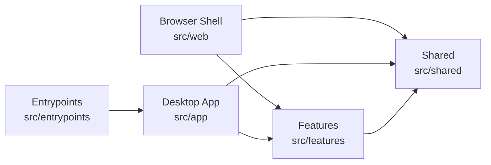
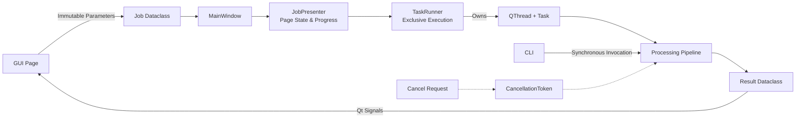

# Architecture and Data Flow

<p align="left">
  <a href="../architecture.md">简体中文</a> · <strong>English</strong>
</p>

## Design Goals

Purivox decouples user interfaces, feature packages, and shared infrastructure. The Graphical User Interface (GUI) and Command-Line Interface (CLI) serve as lightweight wrappers responsible for collecting parameters, dispatching execution, and reporting progress and results. Core processing routines are implemented as pure Python functions independent of GUI dependencies, allowing the desktop GUI, CLI, and WebAssembly browser runtime to execute identical pipelines while facilitating headless automated testing.

## Layered Architecture

```text
src/entrypoints/                 Entry points: startup shims for GUI and CLI
src/app/                         Desktop shell: MainWindow, presenters, and thread runners
src/features/                    Feature implementations: pages, models, and domain pipelines
├── reference_removal/           Reference cancellation: matching, timeline, dual engines, and DSP
├── stem_split/                  Acoustic stem split: channel dispatch, crossovers, and adaptive panning
├── home/                        Landing view and navigation shortcuts
└── settings/                    Configuration, localization, and release update checks
src/shared/                      Shared foundations: audio I/O, general DSP, config, logging, and UI cards
src/web/                         WebAssembly runtime shell: JS bridge, timeline serialization, and memory limits
src/resources/                   Static assets: translation catalogs and SVG brand assets
```

Dependencies flow strictly top-to-bottom:



`src/app` and `src/web` are peer orchestration shells: `app` manages desktop Qt components, while `web` interfaces with the Pyodide WebAssembly runtime.

### Architectural Invariants

`tests/test_architecture.py` verifies the following AST import boundaries:
- `src/shared/` must never import from `app`, `entrypoints`, or `features`;
- Feature modules (`features/`) must never import from each other;
- Neither `app` nor `web` may import from `entrypoints`;
- Components shared across multiple features or entry points must reside in `src/shared/` (e.g., `BLOCK_FRAMES`, `AUDIO_EXTENSIONS`, `log_flux_bands()`, and `validate_reference_settings()`).

URL download utilities (wrapping yt-dlp) reside in `src/shared/download/` and are imported dynamically in GUI slots to preserve fast desktop startup times. The WebAssembly runtime excludes download tools.

## Task Execution Model

UI components emit start and cancel signals rather than managing thread lifecycles directly.



1. **State Coordination**: `MainWindow` constructs immutable job objects and delegates UI state and progress to `JobPresenter`; each page shows its own result through `show_result()`, so `JobPresenter` depends on no feature;
2. **Thread Exclusivity**: `TaskRunner` in `shared/tasks.py` manages the lifecycles of the `QThread` and its task, enforcing that each window runs at most one background task concurrently; the download dialog's `DownloadRunner` reuses the same runner;
3. **Clean Teardown**: `TaskRunner` emits its `finished` signal only after thread deferred deletion completes, preventing race conditions during application shutdown or test teardown;
4. **Cooperative Cancellation**: CLI and GUI share a cooperative `CancellationToken`. Long-running processing loops periodically invoke `raise_if_cancelled()` to respond to abort signals.

## Audio Data and Memory Management

The primary audio container is `AudioData`, representing `[channels, frames]` planar `float32` arrays. Audio processing utilizes chunked streaming and disk mapping:

- **Chunked Processing**: Intensive operations (decoding, analysis, resampling, writing) process blocks of `BLOCK_FRAMES = 262144` frames;
- **Fallback Decoding**: Formats unsupported by libsndfile fall back to Qt Multimedia pipeline decoders;
- **Resampling**: High-quality sample rate conversions use streaming libsoxr;
- **Memory Mapping**: Desktop audio paths write temporary data to `np.memmap` files, calling `release_mapped_pages()` to unmap completed chunks;
- **WebAssembly Adaptation**: Under WebAssembly (Emscripten), where virtual filesystems reside directly in heap memory, `create_pcm_audio` allocates directly on the heap to avoid duplicate memory copies (see [Browser Build](web.md));
- **Atomic Writes**: WAV exports write to temporary sibling files before executing atomic replacements (`os.replace`), preventing corrupt files from partial runs or cancellations.

## Dual-Engine Architecture

The unified entry point `run_isolation_job` first executes source matching via `analyze_stage`, then dispatches execution to an engine based on geometric duration criteria:

```mermaid
flowchart TB
    input["Recording + Reference Tracks"] --> match["Source Matching<br/>analyze_stage"]
    match --> choice{"Geometric Criteria"}
    choice -->|Single Equal-Length Track (Unedited)| whole["Whole-File Path<br/>run_reference_job"]
    choice -->|Matched Clips| stage["Segmented Path<br/>render_stage_job"]
    whole --> out["PCM WAV Export<br/>Native Recording Spec"]
    stage --> out
```

### Whole-File Path

Pipeline: stereo loading $\to$ source resampling $\to$ global tempo estimation and WSOLA stretching $\to$ coarse delay alignment and drift tracking $\to$ complex subtraction and residual masking $\to$ atomic export.

Optimized for full-length song captures, applying unified clock drift and phase alignment across the entire recording.

### Segmented Path

Pipeline: fingerprint extraction $\to$ candidate clustering and timeline construction $\to$ prefilling output with live audio $\to$ iterating active clips $\to$ slice extraction and tempo stretching $\to$ local drift alignment (validated via $2\times2$ direct fit residual gating) $\to$ complex cancellation $\to$ 50 ms cosine crossfade $\to$ atomic export.

Unmatched intervals preserve native live recording audio without truncation.

### Format Integrity

All export paths strictly match the native live recording specifications:
- Sampling rate equals the input recording sampling rate;
- 8-bit and 16-bit PCM inputs export as 16-bit PCM;
- 24-bit/32-bit PCM, floating-point, and lossy inputs export as 24-bit PCM.

Artificial upsampling is prohibited.

## Responsive UI Architecture

Desktop window geometry adapts across four responsive layout modes evaluated in `src/shared/ui/responsive.py`:

| Mode | Width (px) | Layout Structure |
|---|---|---|
| `PORTRAIT` | $< 620$ | Single column; controls stack vertically below labels |
| `HALF` | $< 960$ | Single column; controls inline with labels, tightened padding |
| `LANDSCAPE` | $< 1440$ | Single column; standard margins |
| `ULTRAWIDE` | $\ge 1440$ | Dual columns; content clamped to 1760 px maximum, centered |

Layout metrics are determined by `PageScrollArea` and propagated down the hierarchy. Status labels and dropdowns utilize `shared.ui.allow_shrinking()` to prevent long file paths from expanding column widths.

## Localization, Configuration, and Logging

- **Configuration**: Managed via the QFluentWidgets `QConfig` singleton.
- **Localization**: Uses Qt Linguist XML catalogs (`src/resources/i18n/*.ts`), compiled to binary `*.qm` files loaded by `QTranslator`. Translations are accessed via `shared.i18n.tr(key, **values)`. Language changes trigger page-level `retranslate()` handlers.
- **Progress Protocol**: Processing pipelines issue untranslated key events via `shared.progress.report_progress()`, allowing both Qt desktop and WebAssembly web frontends to render localized progress text.
- **Log Rotation**: Daily logs append to `logs/YYYY-MM-DD.log` under the user data directory, automatically purging expired files on startup.

## Error Handling Boundaries

- **Anticipated Failures**: Missing files, path collisions, and parameter violations raise `FileNotFoundError`, `KeyError`, or `ValueError`. The CLI exits with code 2 for anticipated errors, 1 for unhandled exceptions, and 130 for cancellation. The GUI presents errors via InfoBar notifications.
- **Unhandled Exceptions**: Intercepted by `src/app/crash_handler.py`:
  1. Full tracebacks are logged with CRITICAL severity to the active daily log file;
  2. A diagnostic dialog opens, offering a button to launch the system default text viewer on the log;
  3. GitHub Issue URLs prefill only system version, OS platform, and exception type, omitting local paths to avoid URL length errors (HTTP 414) and sensitive path disclosure;
  4. Detailed log excerpts are copied to the system clipboard only upon clicking "Submit Issue", allowing users to inspect contents before submitting;
  5. Diagnostic dialogs are limited to a single instance per session to prevent infinite dialog cascades during UI repaint events.
