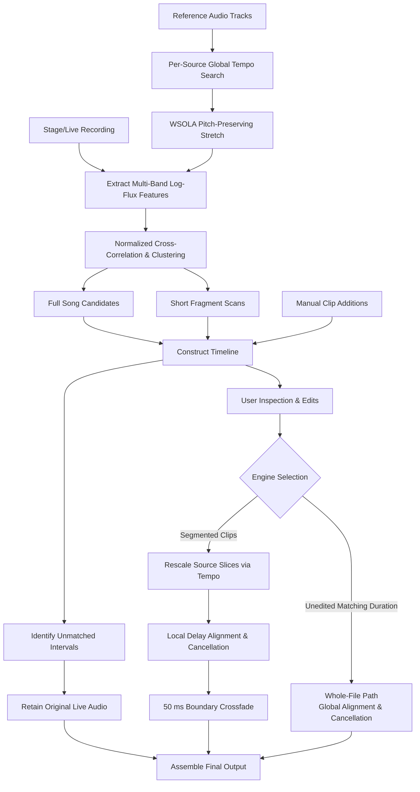

# Source Matching, the Timeline, and Segmented Rendering

  <a href="../matching.md">简体中文</a> · <strong>English</strong>

## Scope and Architectural Boundaries

The reference cancellation workflow shares a unified entry point: `run_isolation_job(job, analysis, token, progress)`, called identically by the GUI, CLI, and WebAssembly browser runtime. This document details the source matching engine: locating one or more studio reference tracks within continuous stage recordings, generating an editable timeline, and executing segmented cancellation. For the single-source whole-file path, see [Reference Cancellation](reference-removal.md).

Input audio tracks do not require manual sorting. When a track recurs across an intro, outro, or intermission, the algorithm detects multiple discrete instances. The analysis stage produces an editable timeline without mutating underlying audio; unassigned time intervals strictly retain the original live audio.

### Engine Selection Rules

The pipeline selects its processing engine based on input geometric durations:

1. **Whole-File Path**: When given a single reference track whose duration matches the recording within 1 second (`_WHOLE_RECORDING_TOLERANCE_SECONDS`) and the timeline has not been manually edited, the engine assumes full coverage and invokes `run_reference_job` for global alignment and cancellation.
2. **Segmented Path**: When multiple clips are detected or the reference track is significantly shorter than the recording, `render_stage_job` aligns and cancels each segment individually.
3. **Fallbacks and Errors**: If a single reference yields no candidate matches, the pipeline falls back to the whole-file path. If multiple references are provided and none can be matched, or if all detected clips are unchecked, processing raises an error.
4. **Manual Edits**: If the input `analysis` contains user-confirmed or manually modified clips, the segmented engine renders the timeline as defined without automatic engine reassignment.

Evaluations demonstrate that for whole-file live recordings with global clock drift, the whole-file engine achieves $1$–$2\text{ dB}$ deeper cancellation due to unified time stretching; conversely, for isolated clips within longer recordings, the segmented path yields $2$–$4\text{ dB}$ better suppression.

## Global Tempo Estimation

Stage recordings frequently suffer from subtle playback speed shifts. Because anchor matching relies on fixed sliding windows, speed mismatches prevent correlation peaks from aligning. The engine performs a global scale search before feature extraction: reference onset representations are linearly interpolated across candidate speeds and cross-correlated against the first two minutes of the live proxy signal.

The search sweeps $0.88$–$1.15$ using a two-tier grid ($0.004$ coarse step, $0.0005$ fine step). Candidates satisfying correlation, margin, and minimum shift ($\ge 0.2\%$) thresholds are accepted, followed by WSOLA time stretching. The estimated tempo ratio is stored per timeline entry and applied to source slices during rendering.

## Feature Extraction and Fingerprinting

The recording and reference tracks are downsampled to $4\text{ kHz}$ mono proxies and analyzed via STFT with $\approx 40\text{ ms}$ hop sizes. Linear magnitude spectra undergo $\log(1 + x)$ compression, half-wave difference rectification, and aggregation into $12$ logarithmically spaced frequency bands.

Each band is normalized by subtracting its sliding median, dividing by the median absolute deviation (MAD), and clipping to $[-8, 8]$. This emphasizes transient onset contours while minimizing master loudness and equalization discrepancies. The feature extraction logic is unified in `shared.dsp.log_flux_bands()`, shared with coarse alignment.

## Full Song Candidate Clustering

Up to $7$ representative anchors ($6$–$20\text{ s}$ duration) are selected per reference track. Each anchor is cross-correlated with the live recording features:

$$
s(k) = \frac{\langle \mathbf S_k, \mathbf Q\rangle}{\|\mathbf S_k\|_2\,\|\mathbf Q\|_2 + \varepsilon}
$$

Detected peaks translate to candidate start offsets in the recording. Peaks within $0.8\text{ s}$ are merged into clusters; confidence scores combine multi-anchor vote counts and average correlation scores.

Each reference track is assigned at most one full song placement, rejecting candidates overlapping existing selections by more than $2\text{ s}$. The final timeline is sorted chronologically by stage start time.

## Short Fragment Detection

To detect short quotes, intro loops, or stage interludes, a sliding $10\text{ s}$ window with a $5\text{ s}$ step scans the reference tracks, focusing on the first and last $75\text{ s}$ of the recording. Candidates undergo secondary verification via cross-correlation on first-difference $4\text{ kHz}$ waveforms.

Short fragments require a minimum duration of $\approx 5\text{ s}$ and cannot significantly overlap full song matches. By default, they are enabled for cancellation and can be disabled via the timeline UI.

## Timeline Model

The analysis routine `analyze_stage(job, token, progress)` outputs a `StageAnalysis` data structure:

| Clip Kind | Description | Default Action |
|---|---|---|
| Full Song | Primary high-confidence match | Enable cancellation |
| Short Fragment | Repeated short quotation or loop | Enable cancellation |
| Unmatched | Unassigned interval | Retain live recording |
| Manual | User-defined custom clip | Enable cancellation |

Each clip record stores stage start/end times, reference source path, reference start/end times, tempo stretch ratio, confidence score, and enabled status.

The desktop GUI implements a model/view architecture: `TimelineModel` (subclassing `QAbstractTableModel`) wraps `StageAnalysis` directly. Updates and inputs are validated in `setData()`; invalid edits trigger `edit_rejected` and revert to previous values. Clip additions and deletions use `add_manual_clip` and `remove_manual_clip` in `matching.py`, shared by the WebAssembly frontend.

### Manual Clips and Medley Edits

For medleys or rearranged live edits, automatic placement can be supplemented using "Add clip". Users edit stage boundaries and reference ranges directly. Manual clips carry a "Manual" confidence label and default to unit tempo ($1.0$).

Automatically detected clips can be unchecked but not removed, preserving an audit trail of detected segments. Manually added clips can be freely removed.

## Segmented Rendering Pipeline

Rendering is performed by `render_stage_job(job, analysis, token, progress)`:

1. **Buffer Allocation**: Allocates an output memory-mapped floating-point buffer matching the live recording duration and channels, prefilled with original audio.
2. **Slicing and Resampling**: Reads and resamples corresponding reference segments to the recording sampling rate.
3. **Tempo Stretching**: Applies WSOLA pitch-preserving stretching if the clip tempo ratio differs from $1.0$.
4. **Local Delay Tracking & Gating**: Evaluates local delay tracking. To prevent inaccurate trajectories from degrading valid timeline boundaries, the engine computes $2\times2$ direct fit residuals; alignment is adopted only if residual metrics improve upon the unaligned timeline.
5. **Complex Subtraction and Masking**: Applies frequency-domain cancellation and residual masking using only signals reconstructed from the live mix.
6. **Boundary Crossfades**: Blends processed segments back into the output buffer with up to $50\text{ ms}$ raised-cosine crossfades.
7. **Backing Stem Generation**: If backing export is enabled, transfer gains are applied to aligned reference slices and mixed into a parallel backing buffer.
8. **Atomic Export**: Writes PCM WAV files atomically at the native sample rate and bit depth of the live recording.

## Failure Policies and Boundary Conditions

1. **Multi-Source Match Rejection**: If multiple reference tracks are supplied but none can be placed, or if all candidate clips are unchecked by the user, the engine raises `ValueError` and refuses to render. This prevents writing untouched audio files masquerading as successful cancellations. A single unplaced source falls back to whole-file processing.
2. **Onset Feature Boundaries**: Spectral flux relies heavily on percussive drum onsets. For acapella performances, ambient soundscapes, or recordings where loud crowd cheering completely masks backing rhythm onsets, correlation confidence drops. Users should verify and supplement matches using manual timeline clips.
3. **Geometric Heuristic Edge Cases**: The 1-second duration tolerance heuristic assumes an equal-length source spans the entire performance. If an unrelated track of matching length is inadvertently provided, the whole-file path is triggered; user inspection via the GUI timeline is recommended before processing.
