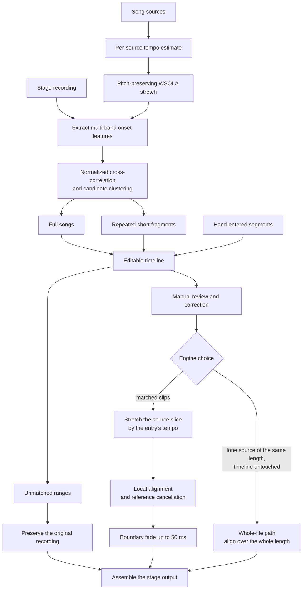

# Source Matching, the Timeline, and Segmented Rendering

  <a href="../matching.md">简体中文</a> · <strong>English</strong>

## Goals and Boundaries

There is one vocal-isolation pipeline, entered through
`run_isolation_job(job, analysis, token, progress)`; the GUI, the CLI and the browser build all call
it. This document covers its matching engine: placing one or more song sources within one continuous
stage recording, building an editable timeline, and rendering it segment by segment. The whole-file
path that cancels one source against one recording over its whole length is
[reference cancellation](reference-removal.md).

Sources do not need to be ordered in advance, and a source that briefly repeats in an intro,
advertisement, or outro can also produce additional fragments. Automatic analysis does not modify
audio directly: it first generates an editable timeline and renders only after user confirmation;
unmatched ranges are always copied from the original stage recording.

Geometry decides the engine, not match quality:

- When clips were matched and the timeline was not edited, a lone source whose length is within one
  second of the recording's (`_WHOLE_RECORDING_TOLERANCE_SECONDS`) is the recording's own content
  and goes through the whole-file path `run_reference_job`; everything else is rendered clip by clip
  by `render_stage_job`.
- When nothing was matched and there is exactly one source, the whole-file path is the fallback too.
- When nothing was matched and there are several sources, or the user disabled every matched clip,
  rendering is refused (`ValueError("no source could be matched to the stage audio")`) - one
  recording against several songs is not a request that "cancel the whole thing once" can answer.
- An `analysis` the caller passes in is the timeline the user checked or edited and is rendered as
  it stands: an edited timeline is a decision, and only an untouched analysis leaves the choice of
  engine to the geometry above.

That geometric rule is measured. For a source as long as the recording, a capture running at a
different tempo makes the matcher place the source a few seconds out, and the whole-file path keeps
1-2 dB more cancellation depth; for a source that starts later in a longer recording the matched
clips are 2-4 dB better. Both numbers come from synthetic scenes.

## Global Tempo

A stage recording may have been re-uploaded with its tempo shifted as a whole: the pitch stays put and
the speed moves by a few percent. The anchor search slides a fixed-width window, so a source at a
different tempo lines up nowhere - measured on real material, two songs were matched to each other's
positions. Every source therefore gets one global scale search before matching: its onset features
are linearly interpolated along time at each trial ratio and normalized-correlated against the stage
proxy with the same spectral-flux features, taking the peak over every lag, scanning 0.88 to
1.15 in 0.004 steps and refining around the peak in 0.0005 steps.

An estimate is accepted only when its peak scores at least 0.25, beats the best ratio outside its own
neighbourhood by 10%, beats the ratio-one score by 0.04, and moves the tempo by at least 0.2%. The
last condition keeps material that is already aligned on its existing path. The estimator and the
stretch both live in `shared/dsp/rate.py` and `shared/dsp/stretch.py`, shared by the matching engine
and the whole-file path.

An accepted ratio stretches the source proxy with WSOLA before the existing anchor search runs, so
the matcher itself is unchanged. The ratio travels with the timeline entry, and rendering stretches
the source slice by it - the source range in the timeline always stays on the source file's own
clock.

## Feature Extraction

The stage recording and every source are first converted to 4 kHz mono proxy signals. A short-time
Fourier transform is then calculated with a frame step of approximately 40 ms. Magnitudes are
compressed with `log1p`, positive spectral flux is retained, and the result is aggregated into 12
geometrically spaced frequency bands.

Each band has its median removed, is normalized by median absolute magnitude, and is clipped to
$[-8,8]$. Matching therefore focuses on onset changes rather than mastering loudness.

The feature itself lives in `shared.dsp.log_flux_bands()`. Coarse alignment in reference cancellation
needs the same onset description, so the band layout, normalization and clipping exist once; source
matching and coarse alignment differ only in window length and rejection threshold.

## Full-Song Candidates

Each source contributes up to seven distributed anchors. Anchor duration adapts to source length
within a range of approximately 6–20 seconds. Every anchor is matched against the stage recording's
features using normalized cross-correlation:

$$
s(k)=\frac{\langle \mathbf S_k,\mathbf Q\rangle}
{\|\mathbf S_k\|_2\,\|\mathbf Q\|_2+\varepsilon}
$$

An anchor hit is converted to the predicted position of source time zero in the recording. Hits
within 0.8 seconds are grouped into one candidate; votes from distinct anchors and their average
score together form the confidence. A candidate needs support from multiple anchors or a
sufficiently high individual score.

After all sources are searched independently, candidates are sorted by votes and confidence. At
most one full-song position is selected for each source, and a candidate overlapping an
already selected song by more than two seconds is rejected. The final timeline is ordered by
stage start time.

## Repeated Short Fragments

To identify short quotations in intros, outros, or advertisements, the algorithm additionally
scans each source with a ten-second window and five-second step, paying particular attention to
approximately the first and last 75 seconds of the recording. In addition to the multi-anchor and
confidence thresholds, a candidate is verified by secondary cross-correlation over the first
difference of the 4 kHz waveforms.

A short fragment must be at least approximately five seconds long and must not overlap a detected
full song or another fragment substantially. They are cancelled along with the full songs; a
fragment the user does not want is skipped by clearing its checkbox in the timeline.

## Timeline Model

`analyze_stage(job, token, progress) -> StageAnalysis` produces this timeline: it reports
`stage_loading` and `stage_fingerprinting` first, `stage_matching_source` for each source it matches,
and `stage_analysis_done` at the end. Entries have these kinds:

| Kind | Meaning | Default processing |
|---|---|---|
| Full song | The primary full-length match for a source | Reference cancellation enabled |
| Short fragment | A local reuse of the same source | Cancelled |
| Unmatched | A gap without reliable source coverage | Preserve original audio |
| Manual | A segment the user entered; the confidence column reads "Manual" | Treated as a full song |

Each matched entry records the stage start/end times, source file, source start/end times, tempo,
confidence, and enabled state. The model rejects negative times, zero-length ranges, matched
entries without a source, and out-of-range confidence.

The tempo column shows the factor the entry's source is stretched by (stage duration divided by
source duration), and reads "-" when no correction was applied. It is read-only: the analysis
measured it, and editing it would have to recompute the source range too, so a wrong estimate is
skipped by unchecking the entry instead. Manual entries are fixed at 1; process a spliced backing
track through the whole-file path to correct its speed first.

After detected occupied ranges are merged, any gap of at least 0.25 seconds produces an unmatched
entry. Sources that were not detected are listed separately for manual review.

The interface presents this table through Qt's model/view classes: `TimelineModel`
(a `QAbstractTableModel` in `features/reference_removal/timeline_model.py`) treats the analysis as
its single source of truth, and `TableView` only displays it. Cell text, alignment, check state, and
editability come from `data()` and `flags()`; user edits are parsed and validated in `setData()`
before they reach the analysis, and an invalid entry returns `False` and emits `edit_rejected`, so
the view restores the previous value on its own. Inserting and removing segments goes through
`add_manual_clip` / `remove_manual_clip` in `matching.py`, and the browser build's timeline calls the
same pair. There is no whole-table repaint and no code that blocks signals raised by its own
repainting; a language change simply makes the model emit `dataChanged`.

### Manual Segments and Spliced Backing Tracks

The analysis places at most one full-song position per source, and the fragment scan is weighted
toward the first and last 75 seconds of the recording. A **spliced backing track** — the same song
cut into pieces and replayed in an order the performance calls for — is outside what that search can
reconstruct.

The timeline therefore accepts hand-entered rows through "Add segment". A new row lands at the
start of the first unidentified range, and the editable stage-time and source-range columns move
it to its real position. Manual segments are full songs rather than fragments: a fragment is
what the matcher found on its own, and a range the user typed in is not one. The confidence column
reads "Manual" rather than inventing a detection score.

Only manual segments can be removed. Detected entries are skipped by clearing their checkbox and
stay in the list for review.

A spliced backing track can also bypass matching: cut the source into the performance's order
first, which yields a source as long as the recording, and hand it to the whole-file path to cancel
in one continuous pass. That returns it to a single continuous alignment problem, but the splice
points have to be accurate to within tens of milliseconds — local delay tracking corrects at most
2 ms per 0.1 s, so a half second of error takes about 25 seconds to recover from, and cancellation
fails for that whole time.

## Segmented Rendering

`render_stage_job(job, analysis, token, progress)` reports `stage_render_loading` first and
`stage_render_clip` for each entry. It creates a floating-point buffer with the same duration and
sample rate as the stage recording and copies the original audio in full, then processes each
enabled full song and optional short fragment:

1. Read the source and resample it to the stage recording's sample rate.
2. Slice the stage and source ranges specified by the timeline.
3. Stretch the source slice by the entry's tempo when it is not 1, preserving pitch.
4. Optionally perform local drift alignment.
5. Measure how well both the original timeline position and drift-aligned result explain the stage
   audio; use drift alignment only when the new result is no worse.
6. Process the segment with reference cancellation. Reconstruction uses only the original
   stage mix and never mixes the source waveform into the result.
7. Blend the result into the recording copy with fades of up to 50 ms at both boundaries.

After all segments are complete, the output is written atomically as PCM WAV at the stage
recording's own sample rate and bit depth (`analyzing_output`, then `saving`). Unmatched ranges are
already a bit-exact copy of the original, so raising the export to a fixed floor would only enlarge
the file without adding spectral detail absent from the original recording.

When the backing track is also requested, the stage recording less the render is written as a
second file once the vocal is on disk, subtracted in place. The render buffer started as a copy of
the stage and had each segment blended over it, so the difference is exactly what was cancelled:
across unmatched ranges the two are identical and the backing is silent there - nothing was
cancelled out of them. The 50 ms fades at the segment boundaries stay consistent too, with the
backing fading under the same weights.

Explanatory power is calculated by fitting small $2\times2$ direct models in multiple windows,
measuring their residual ratios, and taking the median, so that one abnormal window cannot
dominate the decision. This selection gate prevents an already correct timeline position from
being damaged by an unreliable local-delay trajectory.

## Failure Strategy

- Rendering is refused when there are no usable matches and more than one source, rather than
  producing an input-identical file that appears successful; a lone source that cannot be located
  falls back to the whole-file path.
- An unreliable tempo estimate, too small an improvement, or a change below 0.2% is treated as 1:1,
  exactly as before the feature existed.
- The output cannot overwrite the stage recording or any source, and the stage recording cannot also
  be used as a song source.
- Temporary audio for each segment is cleaned immediately after processing; mapped storage keeps
  memory use under control for the full output.
- Disabled or unmatched ranges are never replaced with silence, removed from the timeline, or
  allowed to change the original duration.
