# Reference Cancellation Implementation

  <a href="../reference-removal.md">简体中文</a> · <strong>English</strong>

## Mathematical Formulation and Problem Modeling

Let the two-channel stage or live recording be $\mathbf{y}(t)$, the studio reference track be $\mathbf{x}(t)$, and non-playback components such as live lead vocals, speech, and audience acoustic environment be $\mathbf{v}(t)$. In the Short-Time Fourier Transform (STFT) domain, the stage playback is modeled as the reference signal filtered by a time-varying, frequency-dependent $2\times2$ complex transfer matrix $\mathbf{H}(t, f)$:

$$
\mathbf{y}(t, f) \approx \mathbf{H}(t, f)\mathbf{x}(t, f) + \mathbf{v}(t, f)
$$

Cancellation operates in a two-stage cascade: first, complex subtraction removes linearly correlated playback components; second, a soft mask suppresses non-coherent leakage and transfer mismatches. Denoting the linear prediction as $\mathbf{d} = \mathbf{H}\mathbf{x}$, the first stage computes:

$$
\mathbf{e} = \mathbf{y} - \gamma\,\mathbf{d},\qquad
\lvert\mathbf{e}\rvert \leftarrow \min\bigl(\lvert\mathbf{e}\rvert,\,\lvert\mathbf{y}\rvert\bigr)
$$

The second inequality enforces an energy non-expansion constraint, guaranteeing that the linear subtraction stage cannot amplify signal magnitude. For long reverberation tails and residual delays that cannot be fully captured by the transfer matrix, residual power is regressed against predicted power to estimate leakage $\rho P_d$ (see "Leakage Estimation"), followed by a soft suppression mask:

$$
\widehat P_v = \max(P_e - \rho P_d,\, 0.05^2 P_e),\qquad
M = \sqrt{\frac{\widehat P_v}{P_e + \varepsilon}}
$$

The user strength parameter $\alpha \in [0, 1]$ interpolates linearly on the complex spectrogram:

$$
\mathbf{s} = \mathbf{y} + \alpha\,(M\mathbf{e} - \mathbf{y})
$$

When $\alpha = 0$, the output equals the unedited input $\mathbf{y}$, ensuring smooth and monotonic strength adjustment.

Complex linear subtraction relies on least-squares orthogonal projection: the estimated prediction $\mathbf{d}$ lies within the reference subspace $\mathrm{span}(\mathbf{x})$. For elements present in the studio reference but absent from the live mix (such as album-exclusive backing vocals or modified lyrics), cross-covariance expectations satisfy $\mathbb{E}[y\overline{x_j}] \approx 0$. Consequently, transfer coefficients $h$ and predictions $d$ vanish, preventing artificial artifact injection.

### Applicable Boundaries and Physical Constraints

Reference cancellation relies strictly on acoustic coherence between the live recording and the reference track. Several physical factors naturally constrain cancellation depth:
1. **Acoustic Environment and Non-Linearities**: Severe venue reverberation (exceeding analysis window lengths) and PA system non-linear distortion (speaker clipping, power amp saturation) introduce harmonic content absent from the reference, which cannot be eliminated through linear transfer modeling;
2. **Arrangement and Performance Variations**: Live musical alterations (chords, transposed keys, varied drum patterns, or rearranged structures) cause coherence to collapse;
3. **Pickup Artifacts**: Microphone movement and comb-filtering fluctuations degrade local transfer estimation accuracy.

## Processing Pipeline

```mermaid
flowchart LR
    mix["Live Recording"] --> read["Dual-Channel Loading"]
    ref["Reference Audio"] --> read
    read --> rate["Sample Rate Alignment (soxr)"]
    rate --> tempo["Global Tempo Estimation & WSOLA"]
    tempo --> enabled{"Auto Alignment?"}
    enabled -->|Yes| coarse["Multi-Band Flux / GCC-PHAT<br/>Coarse Time Alignment"]
    coarse --> drift["Local Clock-Drift Tracking"]
    drift --> warp["Lanczos Time Resampling"]
    enabled -->|No| mask["Complex Transfer Estimation<br/>Coherent Cancellation + Mask"]
    warp --> mask
    mask --> protect["Peak Protection & Limiting"]
    protect --> output["PCM WAV Export<br/>Native Recording Spec"]
```

## Time and Speed Alignment

### Global Tempo Estimation and Time Stretching

Live recordings and redistributed media frequently exhibit subtle playback speed differences (typically within $\pm 15\%$ while preserving original pitch). Because local clock-drift tracking is constrained to a maximum correction rate of $20\text{ ms/s}$ ($2\text{ ms}$ per $0.1\text{ s}$ step), persistent speed disparities prevent coarse cross-correlation from finding a reliable peak.

The global search procedure operates as follows:
1. **Downsampled Proxy**: Downsamples signals to a $4\text{ kHz}$ mono proxy to reduce correlation overhead.
2. **Feature Interpolation Correlation**: Extracts multi-band log spectral flux from the reference, linearly interpolates feature timestamps across candidate speeds, and computes normalized cross-correlation against the first two minutes of the live proxy. Interpolating features rather than resampling audio reduces search duration from $\sim 2.4\text{ s}$ to $0.23\text{ s}$.
3. **Two-Tier Grid Search**: Performs a coarse search across $0.88$–$1.15$ with a step of $0.004$, followed by refinement in a $\pm 0.0005$ neighborhood around the candidate peak.
4. **Acceptance Thresholds**: A candidate speed is accepted only if: correlation score $\ge 0.25$, score exceeds non-neighborhood peaks by $\ge 10\%$, score exceeds unit speed ($1.0$) by $\ge 0.04$, and tempo deviation is $\ge 0.2\%$. These constraints prevent false corrections on non-stretched material.
5. **WSOLA Time Stretching**: Stretches the reference audio via Waveform Similarity Overlap-Add (WSOLA). Each frame searches within a nominal $\pm 7.5\text{ ms}$ range for maximum waveform continuity, windowed with a $64\text{ ms}$ Hann window at $50\%$ overlap. Channels share identical offsets to preserve inter-channel phase coherence. WSOLA preserves transient definition better than traditional phase vocoders, avoiding transient dispersion and coherence loss.

Tempo search and stretching are implemented purely in NumPy and SciPy under `shared/dsp/rate.py` and `shared/dsp/stretch.py` to maintain WebAssembly runtime compatibility.

### Coarse Delay Alignment

To handle differences between direct sound and live acoustic pickup, the system extracts $12$-band log-flux onset representations (`shared.dsp.log_flux_bands()`), searching for prominent correlation peaks within an overlap window of up to $60\text{ s}$. If band energy is flat or onset features lack confidence, alignment falls back to GCC-PHAT and standard cross-correlation:

$$
R_{\mathrm{PHAT}}(\tau) = \mathcal{F}^{-1}\!\left(\frac{Y(f)\,\overline{X(f)}}{\lvert Y(f)\,\overline{X(f)}\rvert + \varepsilon}\right)
$$

The initial search operates within a narrow window and expands up to $20\text{ s}$ if a peak approaches the boundary.

### Local Clock-Drift Tracking

Oscillator inaccuracies across recording hardware introduce time-accumulated drift. The tracker uses a $16\text{ kHz}$ proxy to estimate local time delays every $0.1\text{ s}$, bounding frame-to-frame delta transitions. Low-coherence frames extrapolate prior trajectory predictions, smoothed with a 3-point median filter to suppress spurious jumps.

That search stays on the $16\text{ kHz}$ grid and only has to find the correlation peak; the delay trajectory $d(t)$ the warp follows is fitted to the peaks' sub-sample positions instead. Each window records its peak by parabolic interpolation, weighted by the square of its correlation, and a Gaussian local-linear regression $3\text{ s}$ wide runs through them with three bisquare reweighting passes, as in LOWESS, which drop windows of tonal content that locked onto a neighbouring periodic peak. Two device clocks apart by tens of ppm move the delay by a fraction of a proxy sample per second, which the grid can only follow in whole steps, while above $4\text{ kHz}$ one proxy sample of delay error is already most of a cycle; a single window's sub-sample refinement is noisy on its own, and the fit averages that noise away. The coarse estimate is up to one feature hop out, and the slew limit makes the grid catch up over about the first second while the windows already see the right peak, so the fitted trajectory covers the opening as well. Its two ends extend along the local slope, and a stretch with no trusted window keeps the grid track.

The delay trajectory resamples the reference signal:

$$
x_{\mathrm{aligned}}(t) = x\bigl(t - d(t)\bigr)
$$

Fractional interpolation employs a radius-3 Lanczos kernel precomputed over $8192$ phases (quantization noise below $-80\text{ dBFS}$). Sliding energy windows use prefix sums to reduce window computation from $O(N \cdot M)$ to $O(N)$.

## Coherent Cancellation and Complex Transfer Estimation

STFT window sizes adapt to the sampling rate, targeting $\approx 46\text{ ms}$ power-of-two lengths ($512$–$4096$ points) with a $75\%$ overlap ($1/4$ hop). At each frequency bin, the normal equations are formed from smoothed reference covariance matrices and cross-power vectors:

$$
R h = c
$$

Where:
- $R_{jk} = \mathbb{E}[x_k \overline{x_j}]$ represents the regularized reference covariance matrix;
- $c_j = \mathbb{E}[y \overline{x_j}]$ represents the cross-power spectrum.

The system builds lower triangular systems solved via bin-vectorized $LDL^H$ decomposition, bounding total channel gain at $2.0$ ($+6\text{ dB}$). The bound is aimed at gains fitted on weak evidence, not at how loud either file was mastered: when the recording's overall level is above the source's (a quiet master, a phone's automatic gain, a PA run hot), the source is first brought up to the recording's level by the ratio of their RMS over the whole call, never down, and the backing track's gain bound follows the same level.

### Multiple Coherence and Shrinkage Estimation

At the least-squares optimum, $\mathbb{E}[|Hx|^2] = h^H c$. Multiple coherence is extracted directly from the solution:

$$
\gamma^2 = \frac{\mathrm{Re}\,(h^H c)}{P_y + \varepsilon}
$$

To compensate for finite-sample degrees-of-freedom overestimation, the effective sample size $N_{\text{eff}}$ yields adjusted coherence:

$$
N_{\text{eff}} = \max\Bigl(W \cdot \tfrac{\text{hop}}{n_{\text{fft}}} \cdot 1.5,\; p + 2\Bigr),\qquad
\gamma^2_{\text{adj}} = 1 - (1 - \gamma^2)\frac{N_{\text{eff}}}{N_{\text{eff}} - p}
$$

Where $W$ is the smoothing window length in frames and $p$ is system order. Minimizing expected mean-squared error yields the shrinkage scalar $\gamma$:

$$
\gamma = \frac{\gamma^2_{\text{adj}}}{\gamma^2_{\text{adj}} + \frac{p}{N_{\text{eff}}}\bigl(1 - \gamma^2_{\text{adj}}\bigr) + \varepsilon}
$$

When the reference is uncorrelated, $\gamma \to 0$ and the linear stage bypasses the input signal unchanged.

Diagonal regularization thresholds are bounded below by median spectral energy to prevent unstable amplification during quiet reference passages.

### Leakage Estimation

Residual power $P_e$ is regressed against predicted power $P_d$ with an intercept to account for reverberant and acoustic mismatch leakage:

$$
P_e \approx \rho(f, n)\,P_d(f, n) + c(f, n)
$$

Here, $\rho P_d$ captures residual playback fluctuations while $c$ accounts for steady-state live program material. The regression slope $\rho$ is thresholded and bounded by residual power to drive soft residual attenuation.

### Incoherent Power Path

When high-frequency phase coherence collapses (e.g., complex coherence drops below $0.1$ above $500\text{ Hz}$), a parallel log-magnitude power regression is evaluated:

$$
P_y \approx g(f, n)\,P_x + c(f, n)
$$

With gain constrained to $g \ge 0$. Incoherent attenuation is capped by `_INCOHERENT_MAX_SHARE` and filtered across time (`_MASK_POWER_SMOOTH`) to prevent musical noise artifacts.

### Literature and Industry Comparisons

- **Adaptive Filtering & Spectral Subtraction**: Gorlow, Ramona, and Pachet's study on [accompaniment removal in live solos](https://arxiv.org/abs/1611.08905) compares adaptive filtering and subband Wiener filtering. Purivox adopts STFT complex subtraction coupled with adjusted coherence masking.
- **Spectral Subtraction Foundations**: Boll's [classic spectral subtraction paper](https://doi.org/10.1109/TASSP.1979.1163209) addresses musical noise; here, nonlinear subtraction is applied exclusively to post-linear residuals.
- **Echo Cancellation Parallels**: The tiered structure mirrors WebRTC AEC3 (delay estimation, linear cancellation, residual suppression), formulated in batch frequency-domain least-squares for parallel processing.

## Specification Integrity and Verification

Outputs undergo finite-value sanity checks and dynamic peak protection. Exported PCM WAV files match input sampling rates and format bit depths (16-bit for 8/16-bit inputs; 24-bit for float, lossy, or wider inputs).

Automated tests verify delay offsets, drift tracking, tempo criteria, phase inversions, room transfer responses, uncorrelated reference immunity, and chunk boundary transitions. The evaluation suite `tools/eval_cancellation.py` measures cancellation depth and waveform fidelity across synthetic test scenes.

## Export Stem Modes and Non-Additive Trade-Offs

The pipeline supports two output stems:

1. **Isolated Live Vocal**: Direct result of coherent subtraction and residual masking.
2. **Reconstructed Backing**: Synthesized from the studio reference through estimated transfer gains:

$$
g(f, n) = \sqrt{\frac{\widehat P_b(f, n)}{P_x(f, n)}}
$$

Smoothed gains modulate the reference spectrogram, producing a backing track that mirrors stage acoustic frequency response and levels while retaining studio transient fidelity. When exporting both stems, backing tracks receive a `_backing` suffix.

### Non-Additive Reconstruction Note

Importantly: **isolated live vocal stems and reconstructed backing stems do not sum back to the original recording**. This non-additive behavior arises because:
- The reconstructed backing stem is re-synthesized from the clean studio reference and excludes stage reverberation, room reflections, and ambient noise;
- The vocal stem undergoes nonlinear residual soft-masking.

This is an intentional engineering trade-off that prioritizes delivering a clean, studio-grade backing track over strict additive mathematical decomposition. In unassigned timeline intervals where no reference match exists, the backing track outputs pure silence.
