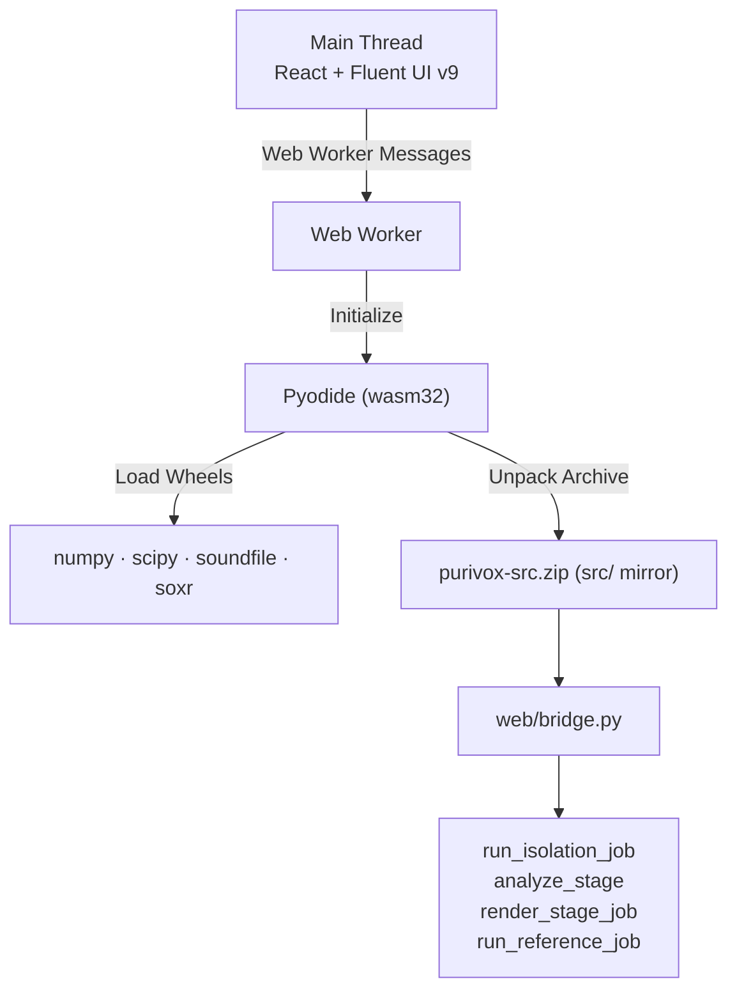

# Browser Build (WebAssembly)

<p align="left">
  <a href="../web.md">简体中文</a> · <strong>English</strong>
</p>

**Live Deployment: <https://purivox.wwchun.top/>**

The Purivox browser build is a backend-free static web application operating alongside the desktop GUI and CLI. Powered by [Pyodide](https://pyodide.org/), it compiles and runs core Python signal-processing pipelines directly in WebAssembly. Hosted statically on GitHub Pages, **it requires no backend server**: audio data remains entirely inside the user's browser tab.

## Scope of Support

| Feature Module | Browser Support | Notes |
|---|:---:|---|
| Vocal Isolation (Matching + Timeline + Dual Engines) | ✅ | Fully ported and verified without Qt dependencies |

Core DSP algorithms reuse the code under `src/features/` directly, packaged into `purivox-src.zip` during build. No separate TypeScript implementations exist.

## Runtime Architecture



- `src/web/bridge.py`: JSON-based bridge interface between JavaScript and Python, avoiding object proxy lifecycle leaks;
- `src/web/timeline.py`: Timeline data serialization calling matching routines in `matching.py`;
- `src/web/limits.py`: WebAssembly heap memory quota estimation and pre-execution rejection gates;
- `web/`: Vite + React web application mirroring Python module organization.

## Frontend Architecture

The frontend project resides in `web/src/` organized by domain feature:

```text
web/src/
  main.tsx                       Application entrypoint
  app/App.tsx                    App shell: navigation, theme, runtime bootstrapping
  features/
    reference_removal/           Isolation UI: MrPage.tsx, Timeline.tsx, job.ts
    settings/                    Settings UI: SettingsPage.tsx
  shared/                        Shared utilities
    runtime/                     PurivoxClient, worker protocol, task hooks
    worker/                      Pyodide worker lifecycle
    audio/                       Browser decoding and chunked uploads
    i18n/  ui/  jobs.ts  theme.ts
```

Frontend architecture is checked statically via `scripts/check-architecture.mjs`, enforcing that `shared` remains domain-independent and feature packages do not import each other.

## Adaptations for Qt-Free and Single-Threaded Environments

1. **Localization Decoupling**: `shared/i18n.py` degrades gracefully without Qt, forwarding raw translation keys so the frontend can render strings from precompiled JSON catalogs.
2. **Sequential Dispatch**: Because Pyodide CPython lacks POSIX thread pooling, `process_audio` incorporates a sequential processing branch whose output is bit-identical to the multi-threaded path (verified by `tests/features/reference_removal/dsp/test_algorithms.py`).
3. **Direct Heap Allocation**: In Emscripten, `mmap` cannot alias memory directly to the wasm32 heap. To prevent redundant allocations, `create_pcm_audio` allocates audio arrays directly on the heap.
4. **Strided STFT Slicing**: `shared/dsp/spectral.py` extracts frames via direct stride hops rather than large intermediate matrices, preventing index overflows on 32-bit wasm32 addressing.

## Frontend Implementation Details

- **Dependency Loading & Progress**: Pyodide and scientific wheels total $\sim 23\text{ MB}$. The loader presents four distinct loading phases, leveraging parallel downloads to minimize cold start time.
- **Chunked File Uploads**: Files are written into Emscripten virtual storage in $4\text{ MiB}$ chunks, providing total length headers upfront to allocate contiguous space.
- **Custom Preview Player**: Built on the Web Audio API with Fluent UI styling, featuring continuous timeline scrubbing and text-labeled controls to avoid intrusive tooltip popovers.
- **Persistent State**: Tabs hide via CSS rather than unmounting, maintaining background task execution and audio playback across navigation.
- **Responsive Layout**: Inherits desktop breakpoints, stacking controls vertically on mobile viewports.

## Memory Budgeting

The wasm32 architecture imposes a $4\text{ GB}$ address space limit. `src/web/limits.py` enforces a conservative budget ceiling of `WASM_BUDGET_BYTES = 2.6 GB` (reserving headroom for runtime and heap fragmentation):

```text
Segmented:  input + 2×stage + 4×source_max + backing + export + DSP_workspace
Whole-File: input + stage + 2×source + max(stage, source) + backing + export + DSP_workspace
```

Jobs exceeding this budget are rejected prior to execution with an invitation to use the desktop application; warnings trigger at $60\%$ utilization.

## Task Cancellation and Lifecycle

Because Pyodide runs synchronously in the Web Worker thread, cancellation cannot rely on polling interrupts. Cancellation is accomplished by **terminating the active Web Worker and re-initializing the runtime**. File references (`File`) are preserved in JavaScript memory and restored automatically upon worker re-instantiation.

## Audio Decoding Strategy

For formats unsupported by libsndfile (e.g., AAC in MP4), `probe_audio` falls back to the browser's native `AudioContext.decodeAudioData` API before passing converted PCM WAV data to the pipeline.

## Local Development and Deployment

```bash
cd web
bun install
bun run dev       # Start development server at http://localhost:5173/
bun run check     # Run linting, TypeScript compiler, and architecture checks
bun run build     # Build production bundle in web/dist/
```

Static assets can be hosted on GitHub Pages or any standard static file host.
