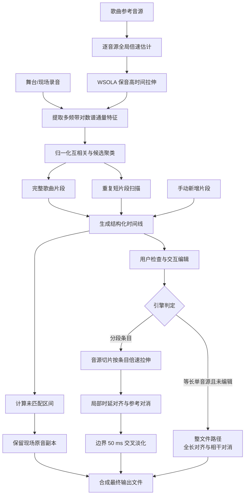

# 音源匹配、时间线与分段渲染

  <strong>简体中文</strong> · <a href="en/matching.md">English</a>

## 功能目标与架构边界

参考对消统一入口为 `run_isolation_job(job, analysis, token, progress)`，GUI、CLI 与 WebAssembly 浏览器端均调用该接口。本文档说明其中的音源匹配引擎：在连续的舞台/现场录音中自动定位一份或多份歌曲参考音源，生成结构化时间线，并按条目执行分段渲染。单一音源的全长对消流程参见[参考对消](reference-removal.md)。

输入音源列表无需预先排序；当同一音源在演出片头、片尾或串场中多次出现时，算法能够识别出重复出现的独立片段。自动分析阶段仅计算并输出时间线结构，不修改底层音频；未覆盖的未匹配区间完整保留现场录音原样。

### 处理引擎选择规则

系统根据音频输入的时长几何特征选择执行引擎：

1. **整文件路径优先**：当仅提供单份参考音源、且音源与录音时长差异小于 1 秒（`_WHOLE_RECORDING_TOLERANCE_SECONDS`），若时间线未被人工编辑，判定该音源覆盖整场录音，调用 `run_reference_job` 进行全长对齐与对消。
2. **分段渲染路径**：当识别出多个独立片段、或音源时长显著短于录音时，由 `render_stage_job` 逐段对齐并渲染。
3. **缺省与异常回退**：若单音源未检测到匹配片段，回退至整文件路径尝试全长对消；若提供多份音源且均未匹配成功，或所有识别片段均被用户取消勾选，系统抛出异常并拒绝执行。
4. **人工编辑锁定**：若传入的 `analysis` 已经过用户确认或手动修改，系统严格遵照时间线条目执行分段渲染，不再自动切换引擎。

测试表明，对于存在全局时钟偏差的单曲录音，整文件路径在全局拉伸与长程对齐下对消深度可提升 1～2 dB；而对于仅出现在局部区间的歌曲，分段渲染能够获得 2～4 dB 的对消深度优势。

## 全局倍速校正

现场重放录音可能存在微小的整体速度偏移。由于锚点滑动匹配采用固定时间窗，速度偏差会导致特征峰无法重合。算法在特征提取前对各音源执行全局标尺搜索：将音源起音特征在时间轴上按候选倍速线性插值，与现场录音前两分钟代理信号计算归一化互相关。

搜索在 0.88～1.15 范围内按两级网格推进（粗扫步长 0.004，精修步长 0.0005）。当候选倍速满足相关性、提升度和最小偏差阈值（$\ge 0.2\%$）时予以采纳，随后使用 WSOLA 对音源代理信号执行时间拉伸。倍速校正比率随时间线条目保存，在后续分段渲染时直接作用于对应的音源切片。

## 特征提取与声学指纹

录音与各参考音源首先重采样为 4 kHz 单声道代理信号，以约 40 ms 帧移计算短时傅里叶变换。线性幅度谱经 $\log(1 + x)$ 动态压缩后计算正向差分谱通量，并在对数频率轴上聚合为 12 个几何等比频带。

各频带在时间轴上减去滑动中位数，除以中位绝对偏差（MAD）归一化并截断至 $[-8, 8]$ 区间。该特征突出了起音瞬态包络，有效抑制母带响度与均衡差异对相关性计算的干扰。该特征提取流程由 `shared.dsp.log_flux_bands()` 集中实现，与参考对消中的粗对齐模块保持一致。

## 完整歌曲候选定位

算法对每个音源自适应选取至多 7 个代表性锚点（单锚点长度 6～20 秒）。各锚点特征与现场录音特征执行时域归一化互相关：

$$
s(k) = \frac{\langle \mathbf S_k, \mathbf Q\rangle}{\|\mathbf S_k\|_2\,\|\mathbf Q\|_2 + \varepsilon}
$$

检测到的互相关峰值投影折算为“音源零时刻在现场录音中的对应起始时间”。时间偏差在 0.8 秒以内的候选峰归并为一个聚类，综合多锚点投票数与平均相关系数计算置信度。

各音源独立完成检索后，候选集合按置信度排序。单份音源最多分配一个完整歌曲位置，并剔除与已确定片段重叠超过 2 秒的冲突候选。最终时间线按现场开始时间升序排列。

## 重复短片段检测

针对片头引用、伴奏循环与短广告片段，算法以 10 秒窗口、5 秒步长对音源进行滑动扫描，重点检查录音首尾 75 秒范围。候选片段除需满足多锚点置信度阈值外，还通过 4 kHz 波形一阶差分的二次互相关检验。

短片段时长通常在 5 秒以上，且不与完整歌曲片段显著重叠。在时间线中，短片段默认开启对消，用户可根据需要手动取消勾选。

## 时间线交互模型

分析阶段调用 `analyze_stage(job, token, progress)` 生成 `StageAnalysis` 数据结构。条目类型定义如下：

| 类型标识 | 业务含义 | 默认处理行为 |
|---|---|---|
| 完整歌曲 | 音源在录音中的主要匹配置信区间 | 启用参考对消 |
| 短片段 | 音源局部重复使用的片段 | 启用参考对消 |
| 未匹配 | 无音源覆盖的空闲间隔 | 保留现场原音 |
| 手动片段 | 用户手动新增的自定义片段 | 启用参考对消 |

时间线条目完整记录现场起止时间、对应音源文件、音源内部起止时间、倍速比率、匹配置信度与启用状态。

GUI 采用 Qt 模型/视图架构实现时间线呈现：`TimelineModel`（继承 `QAbstractTableModel`）直接将 `StageAnalysis` 作为数据源。数据更新与输入校验通过 `setData()` 完成，非法输入触发 `edit_rejected` 信号并自动恢复原值。片段的新增与删除通过 `matching.py` 中的 `add_manual_clip` 与 `remove_manual_clip` 执行，WebAssembly 端使用相同的数据接口。

### 手动片段补充与剪辑垫音

对于由同一歌曲不同段落重组拼贴而成的特殊现场伴奏，自动分析可能无法完全覆盖其全部区间。时间线支持通过“添加片段”手动插入条目，用户可直接双击编辑现场与音源对应的时间区间。手动条目匹配度标记为“手动”，倍速默认为 1.0。

自动匹配生成的片段仅支持通过取消勾选跳过处理，不可直接物理删除，以便于后续审计核对；手动添加的片段支持自由移除。

## 分段渲染管线

渲染阶段调用 `render_stage_job(job, analysis, token, progress)` 执行：

1. **输出缓冲初始化**：创建与现场录音同采样率、同声道的浮点内存映射缓冲区，完整复制现场原音。
2. **片段重采样与切片**：读取对应音源并重采样至现场采样率，根据条目设定的时间轴切分片段。
3. **倍速时间拉伸**：若条目倍速比率不为 1.0，使用 WSOLA 对切片音频执行保音高拉伸。
4. **局部漂移对齐与拟合门限**：执行局部时钟漂移对齐。为避免不准确的时钟轨迹破坏时间线精度，算法在多个滑动窗口内建立 $2\times2$ 直接拟合残差评估，仅当对齐后的残差指标不劣于原始时间线时采纳对齐结果。
5. **相干相减与残差掩码**：对片段应用频域复数相减与残差抑制，处理仅使用原混音重建信号。
6. **平滑淡入淡出**：片段起止边界应用至多 50 ms 的余弦窗交叉淡化，无缝混回输出缓冲区。
7. **垫音轨渲染**：若指定导出垫音（Backing），系统在各片段上将估计传递函数调制至对齐音源，并按相同权重混合输出至独立的垫音缓冲区。
8. **原子化导出**：处理完成后，输出缓冲区按现场录音的原生采样率与位深原子替换写入目标文件。

## 失败策略与算法边界

1. **多音源未匹配拒绝**：若提供多份参考音源但均未匹配到有效片段，或用户手动取消了全部片段勾选，系统抛出 `ValueError` 拒绝渲染，防止因误配置导出未经处理的虚假成功文件；单份音源未检出时回退至整文件路径。
2. **特征局限与弱节奏素材**：谱通量特征高度依赖打击乐与节奏性起音。若现场录音为无节奏清唱（A cappella）、环境氛围音乐，或现场观众欢呼声完全掩盖了伴奏瞬态，互相关峰值置信度较低，用户应通过 GUI 时间线进行人工确认或手动补齐。
3. **几何启发式边界**：1 秒时长容差规则假设等长音源对应全曲录音。若用户误将同等时长的无关音频作为唯一音源传入，系统将触发整文件路径，此时建议提前通过时间线进行人工复核。
