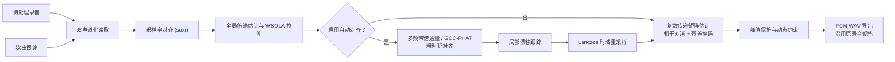

# 参考对消实现

  <strong>简体中文</strong> · <a href="en/reference-removal.md">English</a>

## 算法原理与问题建模

设待处理的双声道录音信号为 $\mathbf{y}(t)$，对应的歌曲参考音源为 $\mathbf{x}(t)$，现场人声、讲话与环境杂音等非重放成分记为 $\mathbf{v}(t)$。在短时傅里叶变换（STFT）时频域中，系统将现场重放建模为经由时变、频变复数传递矩阵 $\mathbf{H}(t, f)$ 滤波后的信号叠加：

$$
\mathbf{y}(t, f) \approx \mathbf{H}(t, f)\mathbf{x}(t, f) + \mathbf{v}(t, f)
$$

对消过程采用两级级联结构：首先通过频域复数相减消除线性相关垫音成分，随后应用非线性软掩码抑制残余非相干成分与传递失配。令预测信号为 $\mathbf{d} = \mathbf{H}\mathbf{x}$，第一级相减计算如下：

$$
\mathbf{e} = \mathbf{y} - \gamma\,\mathbf{d},\qquad
\lvert\mathbf{e}\rvert \leftarrow \min\bigl(\lvert\mathbf{e}\rvert,\,\lvert\mathbf{y}\rvert\bigr)
$$

其中第二式强制残差信号能量不得超过原始混音能量，确保线性相减阶段具有能量衰减约束。对于长混响尾音及残余时延等传递矩阵无法完全拟合的成分，系统通过残差功率对预测功率的局部回归估计泄漏量 $\rho P_d$（详见“泄漏估计”节），并结合软掩码进一步抑制：

$$
\widehat P_v = \max(P_e - \rho P_d,\, 0.05^2 P_e),\qquad
M = \sqrt{\frac{\widehat P_v}{P_e + \varepsilon}}
$$

对消强度系数 $\alpha \in [0, 1]$ 在复频谱上进行线性插值：

$$
\mathbf{s} = \mathbf{y} + \alpha\,(M\mathbf{e} - \mathbf{y})
$$

当 $\alpha = 0$ 时输出完全保持原混音 $\mathbf{y}$，强度调节呈现单调平滑变化。

线性相减基于最小二乘正交投影原理：预测量 $\mathbf{d}$ 落在参考信号张成空间 $\mathrm{span}(\mathbf{x})$ 之内。若参考音源中存在现场混音未包含的内容（如伴奏独有和声或录音室改词），互协方差统计期望 $\mathbb{E}[y\overline{x_j}] \approx 0$，相应的传递系数 $h$ 与预测值 $d$ 均趋于零，避免将参考信号反向混入混音。

### 适用边界与物理局限

参考对消依赖于现场录音与参考音源具有相干声学内容。以下物理因素会对对消深度构成客观限制：
1. **声学环境与非线性失真**：剧烈的现场混响（超出分析窗长度）、PA 扩声系统的非线性失真（如大动态削波、功放饱和压缩）会产生参考信号中不存在的高次谐波，无法仅通过线性传递函数消除；
2. **编曲与演奏变异**：现场乐队伴奏改动吉他/鼓点和弦、变调演奏或重新剪辑排布，均会导致相干性丧失；
3. **拾音干扰**：麦克风手持近距离移动引起的梳状滤波效应（时变相位波动）会降低局部传递估计精度。

## 总体处理流程

## 时间与速度对齐

### 全局倍速估计与保音高拉伸

现场录音或网络二次分发的音频常存在细微的整体变速（如 ±15% 内的非标重放速度）。由于局部时钟漂移跟踪的最大校正速率受限于 20 ms/s（每 0.1 秒最大调整 2 ms），持续的速度偏差会导致互相关粗对齐无法检测有效相关峰。

系统采用全局标尺搜索进行倍速估计：
1. **降采样代理**：将音频转换为 4 kHz 单声道代理信号，降低互相关运算复杂度。
2. **特征插值互相关**：提取参考音源的多频带谱通量特征，对特征序列时间轴按候选倍速进行线性插值，并与录音前两分钟代理信号的对应特征计算归一化互相关。相较于直接重采样原始音频，特征插值将搜索计算耗时从约 2.4 秒降低至 0.23 秒。
3. **两级网格搜索**：首先在 0.88～1.15 范围内以 0.004 为步长粗扫，定位峰值后在峰值邻域以 0.0005 为步长精细搜索。
4. **采纳阈值**：候选倍速需同时满足：相关得分 $\ge 0.25$、高于邻域外次优峰值 10% 以上、较单位倍速（1.0）得分提升超过 0.04，且速度偏差绝对值不低于 0.2%。该判据确保未变速素材不会因随机噪声峰值产生误修正。
5. **WSOLA 时间拉伸**：采纳倍速后，使用波形相似重叠相加（WSOLA）算法对参考信号进行保音高拉伸。每帧在标称位置 $\pm 7.5\text{ ms}$ 内搜索波形连续性最优匹配点，施加 64 ms Hann 窗并以 50% 重叠合成。双声道共用同一时延偏移，以保持声道间相干性。WSOLA 能够保全瞬态信号能量，避免相位声码器引起的瞬态弥散与相干度退化。

倍速拉伸仅由 `shared/dsp/rate.py` 与 `shared/dsp/stretch.py` 内部基于 NumPy 和 SciPy 实现，满足 WebAssembly 无本地动态库的运行约束。

### 粗时延对齐

针对现场环境直达声与麦克风拾音波形相关性较低的特点，系统优先提取 12 频带对数正向谱通量特征（`shared.dsp.log_flux_bands()`），在至多 60 秒的重合区间内检索互相关峰值。若频带特征平坦或峰值不可靠，则回退至广义互相关相位变换法（GCC-PHAT）与标准时域互相关：

$$
R_{\mathrm{PHAT}}(\tau) = \mathcal{F}^{-1}\!\left(\frac{Y(f)\,\overline{X(f)}}{\lvert Y(f)\,\overline{X(f)}\rvert + \varepsilon}\right)
$$

初始搜索窗口设为局部区间，当峰值接近边界时扩展至至多约 20 秒，平衡计算开销与误匹配风险。

### 局部时钟漂移跟踪

录音设备间的晶振频率误差会导致音频时钟随时间产生线性积累偏差。算法使用 16 kHz 代理信号每 0.1 秒估计一次局部时延，并限制相邻帧间的最大时延跳变。在低相关性区间使用前序预测值外推，并应用三点中值滤波消除孤立噪声跳变。

这一搜索停留在 16 kHz 网格上，只负责找到相关峰；重采样所用的时延曲线 $d(t)$ 另由各窗口峰值的亚样本位置拟合得出。每个窗口经抛物线插值记录峰值位置，以相关系数的平方为权重，用 3 秒高斯核做局部线性回归，并按 LOWESS 的方式做三轮 bisquare 稳健重加权，剔除音调性内容锁定到相邻周期峰的窗口。两台设备的时钟偏差每秒只让时延移动零点几个代理采样，网格只能整格跳变，而 4 kHz 以上一个代理采样的时延误差已接近一个整周期；单个窗口的亚样本细化本身噪声很大，拟合把这部分噪声平均掉。粗对齐带有一个特征帧移以内的误差，跳变限制使网格在开头追赶约一秒，这期间各窗口已经看到正确的峰，拟合曲线因此同样覆盖开头。曲线两端按局部斜率外推，完全没有可信窗口支撑的区段沿用网格跟踪值。

时延曲线利用半径为 3 的 Lanczos 核进行分数阶重采样插值：

$$
x_{\mathrm{aligned}}(t) = x\bigl(t - d(t)\bigr)
$$

插值核采用 8192 相位的预计算查找表，量化误差低于 -80 dBFS；滑动窗口能量统计采用前缀和优化，计算复杂度由 $O(N \cdot M)$ 优化至 $O(N)$。

## 相干对消与复数传递估计

短时傅里叶变换（STFT）窗口大小根据采样率取接近 46 ms 的二次幂（介于 512 至 4096 点之间），跳步（hop）为窗口的 1/4。在各频点上，系统基于平滑后的参考协方差矩阵和互功率谱向量求解正规方程：

$$
R h = c
$$

其中：
- $R_{jk} = \mathbb{E}[x_k \overline{x_j}]$，协方差矩阵加入对角正则化项；
- $c_j = \mathbb{E}[y \overline{x_j}]$，互功率谱向量。

系统仅构造下三角矩阵并采用逐频点向量化的 $LDL^{H}$ 分解求解复数传递参数 $h$，单声道总增益上限设为 2.0（+6 dB）。

### 多重相干度与收缩估计

在最小二乘最优点上，理论有 $\mathbb{E}[|Hx|^2] = h^{H}c$。系统直接从正规方程求解结果中计算多重相干度：

$$
\gamma^2 = \frac{\mathrm{Re}\,(h^{H}c)}{P_y + \varepsilon}
$$

为消除有限观测样本引起的过拟合偏置，引入有效自由度 $N_{\text{eff}}$ 计算无偏调整相干度：

$$
N_{\text{eff}} = \max\Bigl(W \cdot \tfrac{\text{hop}}{n_{\text{fft}}} \cdot 1.5,\; p + 2\Bigr),\qquad
\gamma^2_{\text{adj}} = 1 - (1 - \gamma^2)\frac{N_{\text{eff}}}{N_{\text{eff}} - p}
$$

其中 $W$ 为时间平滑窗帧数，$p$ 为系统阶数。基于均方误差最小化准则，推导出收缩因子 $\gamma$：

$$
\gamma = \frac{\gamma^2_{\text{adj}}}{\gamma^2_{\text{adj}} + \frac{p}{N_{\text{eff}}}\bigl(1 - \gamma^2_{\text{adj}}\bigr) + \varepsilon}
$$

当参考信号与混音无关时，$\gamma \to 0$，线性对消级自动旁路，保持原始音频不变。

为防止对角正则项在参考信号能量较低时过小导致病态放大，对角正则设置不低于频点中位数功率计算的绝对阈值下限。

### 泄漏估计

对于窗外混响与失配残余，系统在残差功率 $P_e$ 与预测功率 $P_d$ 之间建立带截距的局部线性回归模型：

$$
P_e \approx \rho(f, n)\,P_d(f, n) + c(f, n)
$$

模型中，$\rho P_d$ 为跟随参考信号同态波动的泄漏成分，$c$ 为平稳的现场背景成分。斜率 $\rho$ 经平滑门限与残差功率上限截断后，用于驱动联动软掩码抑制非相干泄漏。

### 非相干功率通道

当高频声学相干度严重退化时（例如 500 Hz 以上复数相干度低于 0.1），系统启用并行的对数幅度谱功率回归通道：

$$
P_y \approx g(f, n)\,P_x + c(f, n)
$$

要求增益斜率 $g \ge 0$。非相干通道的能量扣除受限于残差功率占比上限（`_INCOHERENT_MAX_SHARE`），并在时间轴施加功率平滑滤波（`_MASK_POWER_SMOOTH`），避免频点跳变产生音乐噪声。

### 文献依据与参考实现

- **自适应滤波与频域减法**：Gorlow、Ramona 与 Pachet 在[现场独奏伴奏消除研究](https://arxiv.org/abs/1611.08905)中探讨了自适应噪声消除与频域减法；本实现采用频域复数相减结合调整相干度软掩码架构。
- **谱减与残余控制**：Boll 的[经典谱减法论文](https://doi.org/10.1109/TASSP.1979.1163209)论述了非线性残差噪声问题；本实现将其应用于复数相减后的残差域，配合泄漏回归与时频平滑控制音乐噪声。
- **回声消除工业对照**：整体多级对齐、线性消除与残差抑制结构与 WebRTC AEC3 设计思路一致，但在频域按分块批量最小二乘解算以支持多核并行。

## 规格保持与保护验证

处理完成后执行有限数校验并施加动态峰值保护。输出 PCM WAV 文件严格遵循现场输入录音的原生采样率与位深格式（8-bit / 16-bit 输出 16-bit；24-bit / 32-bit float / 有损格式输出 24-bit）。

算法测试覆盖时延偏移、漂移跟踪、倍速判据、极性反转、多径频响、无关参考抗扰、矩阵串扰及块边界拼接连续性。辅助评测脚本 `tools/eval_cancellation.py` 提供确定性测试集下的对消深度与波形保真度度量。

## 导出音轨模式与加和性权衡

系统支持双音轨导出模式：

1. **现场人声轨（Vocal）**：由相干相减与残差掩码处理后直接得到。
2. **重构垫音轨（Backing）**：基于估计的传递特性从原始参考音源重新合成，时频增益定义为：

$$
g(f, n) = \sqrt{\frac{\widehat P_b(f, n)}{P_x(f, n)}}
$$

增益矩阵经上下文平滑后调制原始音源复频谱，使重构垫音兼具原始母带的高保真音质与现场重放系统的实际频响与电平。导出两条音轨时，第二条音轨文件名由首条名称追加或替换 `_backing` 后缀生成。

### 非线性加和性说明

需要特别说明的是：**现场人声轨与重构垫音轨线性相加并不严格等于原始现场录音**。原因在于：
- 重构垫音轨是由原始纯净音源经频域增益调制合成的，并未包含现场环境混响、观众杂音与麦克风底噪；
- 人声轨经过了非线性的残差软掩码抑制。

这种非加和性是有意为之的工程权衡，目标是在分离人声的同时提供不受现场声学劣化污染的高品质伴奏重构轨。在无音源匹配的未识别区间，垫音轨严格输出静音。
