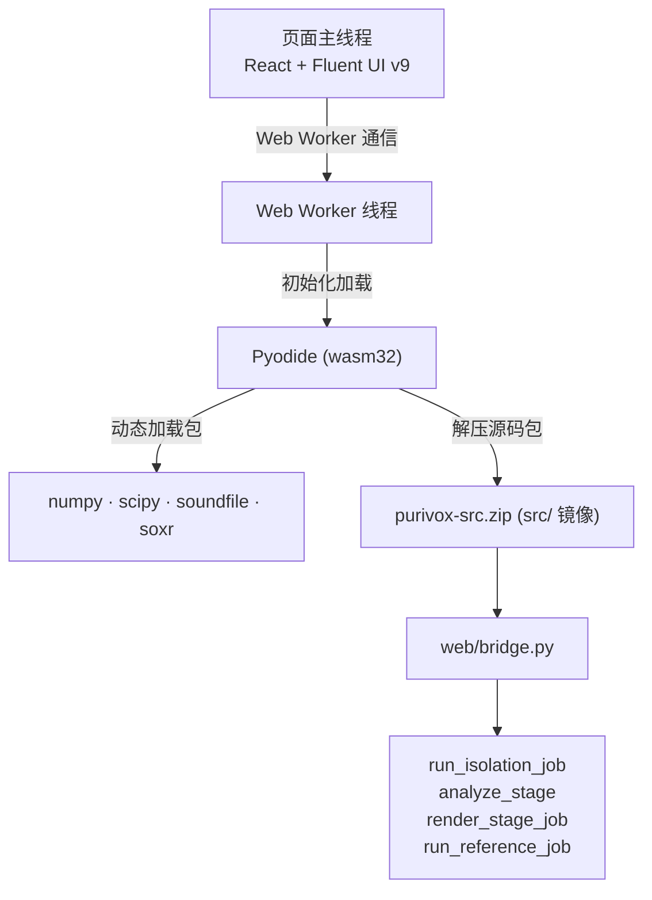

# 浏览器版（WebAssembly）

<p align="left">
  <strong>简体中文</strong> · <a href="en/web.md">English</a>
</p>

**线上部署地址：<https://purivox.wwchun.top/>**

Purivox 浏览器版是与桌面图形界面（GUI）和命令行（CLI）并列的无后端静态应用。它利用 [Pyodide](https://pyodide.org/) 将 Python 核心信号处理管线编译并在 WebAssembly 环境中运行，全站托管于 GitHub Pages，**无需任何后端服务器参与计算**：音频数据全程保留在用户的本地浏览器会话中。

## 功能支持范围

| 功能模块 | 浏览器端支持 | 说明 |
|---|:---:|---|
| 垫音消除（音源匹配 + 时间线 + 双引擎） | ✅ | 核心管线无 Qt 依赖，已完成 WebAssembly 环境适配 |

核心信号处理算法复用 `src/features/` 下的代码实现，构建时通过脚本打包为 `purivox-src.zip`，不存在独立的 TypeScript 算法重复实现。

## 运行架构



- `src/web/bridge.py`：JavaScript 与 Python 间的桥接接口，采用统一的 JSON 字符串协议交互，避免传递 Python 原生字典导致需要前端手动管理内存生命周期的代理泄漏；
- `src/web/timeline.py`：时间线结构序列化接口，增删片段调用 `matching.py` 中的相同实现；
- `src/web/limits.py`：WebAssembly 堆内存配额测算与安全阈值拦截；
- `web/`：Vite + React 前端项目，采用与 Python 端同构的功能分层结构。

## 前端代码架构

前端工程位于 `web/src/`，按业务功能组织：

```text
web/src/
  main.tsx                       应用入口
  app/App.tsx                    主框架外壳：导航、主题、运行时初始化
  features/
    reference_removal/           消音业务：MrPage.tsx、Timeline.tsx、job.ts
    settings/                    设置业务：SettingsPage.tsx
  shared/                        通用模块
    runtime/                     PurivoxClient、Worker 通信协议、任务状态 Hook
    worker/                      Pyodide Worker 线程管理
    audio/                       浏览器端解码与切片上传
    i18n/  ui/  jobs.ts  theme.ts
```

前端代码同样受 `scripts/check-architecture.mjs` 静态分析保护，要求 `shared` 不依赖业务功能，业务功能间互不导入。

## 无 Qt 与单线程环境适配

1. **多语言与进度解耦**：`shared/i18n.py` 在无 Qt 环境中自动降级，进度事件携带原始 key 下发，由前端加载对应的多语言 JSON 进行渲染。
2. **串行任务调度**：Pyodide 编译的 CPython 不支持 POSIX 线程池，`process_audio` 引入串行调度分支，分块计算结果与多线程路径逐位一致（由 `tests/features/reference_removal/dsp/test_algorithms.py` 验证）。
3. **直接堆内存分配**：在 Emscripten 虚拟文件系统中，`mmap` 无法别名映射到 WebAssembly 线性内存，仍需额外复制，因此 `create_pcm_audio` 直接在堆中分配连续内存，避免内存开销翻倍。
4. **跨步切帧优化**：`shared/dsp/spectral.py` 的 `stft` 与 `log_flux_bands` 直接按帧移（hop）跨步提取切片，避免旧实现生成超长临时高维视图导致超出 wasm32 的 32 位寻址空间。

## 前端设计实现

- **依赖加载与粗粒度进度**：Pyodide 运行时及其科学计算依赖包总体积约为 23 MB。页面通过四个粗粒度阶段展示加载状态，并通过一次性 `loadPackage` 并行下载缩短冷启动时间；
- **分块切片上传**：大文件按 4 MiB 分块写入虚拟文件系统，首次切片携带文件总体积以提前分配连续存储；
- **内置试听播放器**：基于 Web Audio API 定制 Fluent UI 风格播放器，进度条支持平滑拖拽，避免原生组件样式不一致与键盘导航弹出层遮挡；
- **页面常驻与防抖**：切换标签页时通过 CSS 隐藏组件而非卸载 DOM，保证后台任务与试听状态不被中断；
- **响应式断点**：继承桌面端的断点规范，在移动端竖屏自动切换为单栏垂直堆叠布局。

## 内存配额预算

wasm32 架构寻址空间上限为 4 GB。`src/web/limits.py` 将安全内存上限 `WASM_BUDGET_BYTES` 设定为 2.6 GB（预留解释器与内存碎片余量）：

```text
分段渲染：输入字节 + 2 × 舞台缓冲 + 4 × 最长音源缓冲 + 垫音缓冲 + 导出字节 + DSP 工作集
整文件：  输入字节 + 舞台缓冲 + 2 × 音源缓冲 + max(舞台, 音源) + 垫音缓冲 + 导出字节 + DSP 工作集
```

超出预算的任务在提交前将被直接拒绝并提示使用桌面版处理；达到 60% 阈值时给出内存占用警告。

## 任务取消与生命周期

由于 Pyodide 在 Worker 单线程中同步执行 Python 计算，无法通过轮询消息响应取消。浏览器端取消操作通过**终止现有 Web Worker 并重新初始化运行时**完成。用户上传的文件对象（`File`）由前端持有引用，Worker 重建后自动重新写入虚拟文件系统，无需用户重新选择文件。

## 音频解码策略

对于 libsndfile 不支持的容器格式（如 MP4/AAC），`probe_audio` 捕获格式错误后回退至浏览器原生 `AudioContext.decodeAudioData` 接口，解码为 PCM 后交由管线处理。

## 本地开发与构建部署

```bash
cd web
bun install
bun run dev       # 启动开发服务器（http://localhost:5173/）
bun run check     # 执行 lint、tsc 与架构边界检查
bun run build     # 生产构建（产物位于 web/dist/）
```

构建生成的静态文件可直接发布于 GitHub Pages 或任意静态托管服务。
